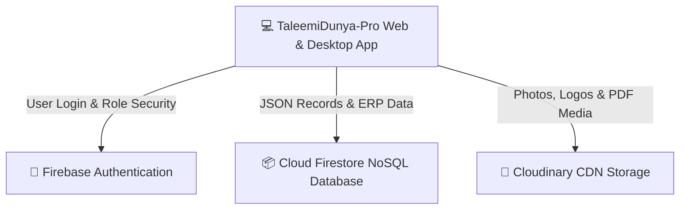
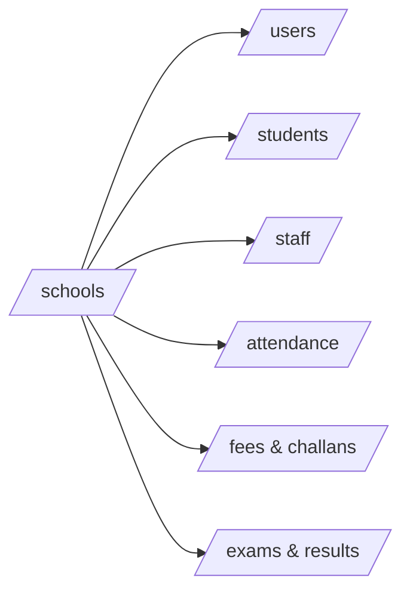

# 💾 TaleemiDunya-Pro — Database & Storage Architecture Roadmap

> **A Comprehensive Guide to How Data, Security, and Media are Handled Across the Platform**

---

## 🌟 1. Dual-Database & Storage Architecture (Overview)

**TaleemiDunya-Pro** ek **High-Performance Cloud SaaS Ecosystem** hai jismein 3 alag alag cloud engines mil kar kaam karte hain:



Har tool ka ek specific aur specialized kaam hai taaki system **Fast**, **Secure**, aur **Cost-Effective** rahe:

| System Engine | Service Used | Purpose & Role in App |
| :--- | :--- | :--- |
| **Identity & Auth** | `Firebase Authentication` | Users ka secure login, passwords, sessions, aur role verification (`super-admin`, `school-admin`, etc.). |
| **Core ERP Database** | `Cloud Firestore (NoSQL)` | School profiles, students, attendance, fee challans, exam marks, aur ledger ka structured data. |
| **Media & File CDN** | `Cloudinary Storage` | Student ID card photos, school logos, homework PDFs, aur study material ki cloud storage. |

---

## 🔐 2. Firebase Authentication (Kis Kaam Ke Liye Use Ho Raha Hai?)

Authentication system sirf simple login ke liye nahi balki **Multi-Tenant Security** ka pillar hai:

1. **Role-Based Access Control (RBAC):** Har user ID ke sath ek specific role attached hota hai:
   * `super-admin` (SaaS Owner)
   * `school-admin` (School Principal)
   * `teacher` (Faculty Member)
   * `student` / `parent` (Users)
2. **Secondary Auth Engine (`SecondaryApp` in `src/services/firebase.js`):**
   * **Problem:** Normal Firebase mein agar Super Admin naya user banaye to wo khud logout ho kar naye user se login ho jata hai.
   * **Our Solution:** Hamara code ek **Secondary Firebase Instance** use karta hai. Jab Super Admin 'Add School' karta hai, to background mein naye Principal ka account banta hai aur Super Admin ka apna session active rehta hai!

---

## 📦 3. Cloud Firestore Database — Complete Collection Mapping

School ka saara structured data **NoSQL Collections** mein save hota hai jahan har doc par `schoolId` ka tag hota hai (Multi-Tenancy):



### 📋 Firestore Collections Breakdown & Their Role:

| Collection Name | Data Saved & Functionality |
| :--- | :--- |
| **`/schools`** | Har school ka master record (School Name, Principal Email, Plan: Basic/Premium, Status: Active/Expired, Revenue). |
| **`/users`** | Har login user ka profile data, Role (`school-admin`, `teacher`), aur wo kis `schoolId` se linked hai. |
| **`/students`** | Students ka admission record, Roll Number, Class & Section, Parent Contact details, aur ID Card status. |
| **`/staff`** | Teachers aur non-teaching staff ka profile, designation, monthly salary, aur attendance history. |
| **`/attendance`** | Daily class-wise student aur staff attendance records (`Present`, `Absent`, `Late`, `Leave`). |
| **`/fees` / `/challans`** | Monthly fee structures, generate kiye gaye **Challan Books** (`/fees/challan-book`), payment receipts, aur defaulter tracking. |
| **`/exams` & `/results`** | Term exams schedule, subject-wise marks entry, aur **Custom Report Card Templates** (`/academics/report-card`). |
| **`/expenses`** | School ke daily expenditures (Electricity bills, rent, maintenance) ka complete financial ledger. |
| **`/library` & `/inventory`** | Books issue/return tracking (`/library`) aur uniforms/stationery stock (`/inventory`). |
| **`/inquiries`** | Naye admission leads (Parents jo information lene aaye) aur unka follow-up status. |

---

## 📁 4. Cloudinary Media Storage (Kis Kaam Ke Liye Use Ho Raha Hai?)

Database (`Firestore`) mein badi images ya PDF save karna mehenga aur slow hota hai. Isliye hamara system **Cloudinary Storage CDN (`dz0mfu4al`)** use karta hai:

### 🖼️ Specific Use Cases in TaleemiDunya-Pro:
1. **Digital Student ID Cards (`/students/id-cards`):**
   * Jab admission form par student ki photo upload hoti hai, to hamara code automatic **Canvas API (`src/services/cloudinary.js`)** se photo ko compress (e.g. 2MB se 150KB) karta hai.
   * Compressed photo Cloudinary par upload hoti hai aur uska secure CDN link (`https://res.cloudinary.com/...`) Firestore student doc mein save ho jata hai.
2. **School Logos & Branding (`/super-admin/schools`):**
   * School ka official logo upload hota hai jo automatically Fee Challans aur Report Cards ke top par print hota hai.
3. **Teacher Study Material & Homework PDFs (`/teacher/material`):**
   * Teachers syllabus, notes aur assignments ke PDF/Word documents upload karte hain jo students aur parents apne portal se instant download kar sakte hain.

---

## ⚡ 5. Advanced Technical Features & Security Engine

### 🌐 A. Offline Multi-Tab Persistence (`persistentMultipleTabManager`)
* Hamara Firebase code (`src/services/firebase.js`) browser ke **IndexedDB** mein data cache karta hai.
* **Faida:** Agar school mein bijli (electricity) ya internet chala jaye, tab bhi Principal aur Teachers attendance lagate rehte hain aur fee challan dekhte rehte hain. Jaise hi internet wapas aata hai, data automatically cloud par sync ho jata hai!

### 🛡️ B. Strict Tenant Isolation (`firestore.rules`)
* **167 Lines of Security Rules** yeh guarantee karte hain ke `School A` ka Principal ya Teacher kabhi bhi kisi galti se ya hack attempt se `School B` ke students ya financial ledger ko access nahi kar sakta (`request.auth.token.schoolId == resource.data.schoolId`).

---

---

## 📥 6. Bulk Data Import & Migration Architecture (`/school-admin/import`)

Aapke panel (**TaleemiDunya-Pro**) mein ab **Bulk Data Migration & Excel/CSV Importer** built-in maujood hai jo kisi bhi naye school ko apni purani Excel sheet se **1,000+ students aur staff ko ek click mein import** karne ki facility deta hai:


### ✨ Bulk Importer Engine ke Key Features (`DataImport.jsx`):
1. **Multi-Module Tab Navigation:** Students (`/students`), Staff (`/staff`), Fee Records (`/fees`), aur Library Books (`/library`) ke liye alag alag migration tabs.
2. **One-Click Sample Templates:** Har tab ke liye **"Download Sample Template (.CSV)"** button maujood hai jisse school admin exact required columns (`rollNumber, name, class, section...`) download kar ke aasani se fill kar sakta hai.
3. **Smart Drag & Drop + Direct Excel Paste Box:** Admins ya toh `.csv` / `.txt` file upload kar sakte hain ya MS Excel se cells copy kar ke direct textarea mein paste kar sakte hain.
4. **Live Validation & Error Highlighting:** Data upload hone se pehle table mein **Green (`OK`)** aur **Red (`Invalid / Missing Data`)** status dikhta hai jahan se kharab rows ko one-click par delete kiya ja sakta hai.
5. **High-Speed Firestore Batch Writes:** Firebase ki `writeBatch()` API use hoti hai jo records ko 400-chunk packets mein upload karti hai aur har record par automatic `schoolId` aur `importedVia` tag laga deti hai!

---

## 🗺️ 7. Database & Storage Scaling Roadmap

```
[Phase 1: Multi-Tenant NoSQL & CDN] ──(LIVE ✅)
      │
      ▼
[Phase 2: Auto-Backups & Audit Logs] ──(Next Step 🔄)
      │
      ▼
[Phase 3: Database Sharding & AI Vector DB] ──(Future 🚀)
```

### Phase 1: Foundation Architecture (Current Status: ✅ LIVE)
* Firebase Auth + Firestore Multi-Tenant Schema + Cloudinary Unsigned CDN with Canvas compression.
* Complete offline local caching for 24/7 uninterrupted school operations.
* **Bulk Excel/CSV Data Migration Engine (`DataImport.jsx`) for instant onboarding.**

### Phase 2: Security & Backup Enhancement (Q3/Q4)
* **Automated Daily Cloud Backups:** Google Cloud Functions ke zariye rozana raat 12 baje poore Firestore database ka automated snapshot export ho kar Google Cloud Storage mein save hona.
* **Financial Audit Logs (`/audit_logs`):** Agar koi Principal ya accountant kisi fee challan ya attendance record ko edit/delete kare, to uski immutable log save hogi (kisne, kis waqt, kya change kiya).

### Phase 3: Enterprise Scale & AI Search (Long Term)
* **Database Sharding:** Jab platform par 10,000+ schools active ho jayenge, to data ko geographic zones (Punjab, Sindh, KPK, Overseas) ke hisab se separate Firestore buckets mein shard karna.
* **AI Vector Database (`Pinecone / PGVector`):** Students ke saal bhar ke attendance aur marks ka vector embedding banana taaki AI Agent seconds mein complex queries ka jawab de sake (e.g., *"Show me all Grade 10 students whose Math scores dropped by 15% this term"*).
