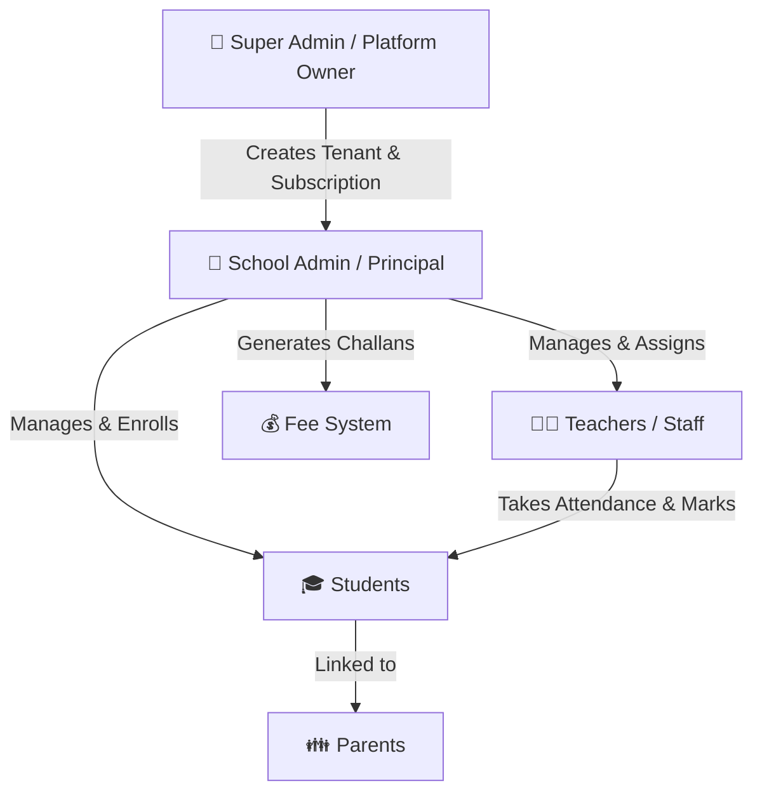

# 🌟 TaleemiDunya-Pro — Master Roadmap & System Overview

> **A Premium Multi-Tenant Cloud SaaS School & Institute Management Ecosystem**

---

## 📖 1. App Kis Kaam Ki Hai? (Executive Summary)

**TaleemiDunya-Pro** ek **Next-Generation Cloud SaaS (Software as a Service) Educational Platform** hai. 
Yeh aam school software nahi hai jahan ek time par sirf ek school chalta hai — yeh ek **Master Platform** hai jahan ek hi software ke zariye **Hazaron Schools, Colleges, aur Academies** register ho kar apna alag alag digital system chala sakte hain!

### 🎯 Main Goal:
Schools ke purane paper-based registers, man-made fee challans, aur attendance copies ko **100% Digital, Automated aur Smart Ecosystem** mein convert karna.

---

## ⚙️ 2. Yeh App Kaise Kaam Karti Hai? (System Architecture & Workflow)

Yeh platform **5 Role-Based Hierarchy (Multi-Tenancy)** par kaam karta hai. Har user ka rasta aur data ek doosre se secure aur alag (tenant-isolated) hota hai:



### 🔁 Step-by-Step Working:
1. **Super Admin (Aap / SaaS Malik):** Platform ka malik `#/super-admin/dashboard` se naye schools onboard karta hai aur unka **Basic, Standard, ya Premium** plan set karta hai.
2. **School Admin (Principal):** Jaise hi school add hota hai, us school ke Principal ka account (`principal@school.com`) ban jata hai. Wo apne portal (`#/school-admin/dashboard`) se apna school setup karta hai (Classes, Fees, Teachers aur Students add karta hai).
3. **Teachers:** Apne portal (`#/teacher/dashboard`) se rozana student attendance lagate hain, homework dete hain, aur exam marks enter karte hain.
4. **Students & Parents:** Apne respective portals (`#/student/dashboard` & `#/parent/dashboard`) se ghar baithe attendance, fee dues (challans), aur report cards check karte hain.

---

## 🚀 3. Kitne Features Hain Aur Kaun Kaun Se Hain? (Complete Features Inventory)

TaleemiDunya-Pro mein **40+ Advanced Modules** aur **5 Dedicated Dashboards** mojood hain:

### 👑 A. Super Admin Panel (SaaS Platform Controller)
| Module | Description & Capability |
| :--- | :--- |
| **Multi-School Manager** | Naye schools register karna, active/inactive status control, aur expiry date tracking. |
| **Subscription & Billing** | Schools ke plans (Basic, Premium) aur SaaS subscription renewal management. |
| **Revenue Analytics** | Platform ki total earnings, monthly MRR graph aur growth track karna. |
| **Global AI Agent Setup** | Platform-wide OpenAI assistant config aur smart prompt controls. |
| **System Notifications & Support** | Schools ki support tickets resolve karna aur global notices bhejna. |

---

### 🏫 B. School Admin Panel (Principal / ERP Powerhouse)
| Module | Description & Capability |
| :--- | :--- |
| **Inquiry & Lead Manager** | Naye admission ke liye aane wale parents ki queries aur follow-ups track karna. |
| **Student Lifecycle ERP** | Complete student profile, admission form, aur **Digital ID Card Generator** (`/students/id-cards`). |
| **Staff & HR Manager** | Teachers ka bio-data, designation, payroll aur attendance tracking. |
| **Smart Attendance Engine** | Daily manual, biometric, ya digital attendance system. |
| **Fee & Challan Ecosystem** | Automated fee calculation, **Challan Book Generation** (`/fees/challan-book`), voucher printing, aur defaulter list. |
| **Smart Timetable Builder** | Automatic aur manual conflict-free class timetable generator (`/academics/timetable-builder`). |
| **Exams & Report Card System** | Exam schedule, marks entry, aur **Custom Report Card Designer** (`/academics/report-card`). |
| **Accounts & Expense Ledger** | School ke rozana ke kharchay (electricity bill, maintenance) aur revenue vs expense tracking (`/accounts/expenses`). |
| **Library & Inventory Stock** | Books issue/return records (`/library`) aur uniforms/stationery stock (`/inventory`). |
| **Transport & Bus Management** | School buses, routes mapping, drivers record aur pick/drop fees (`/transport`). |
| **Communication & SMS Panel** | Bulk SMS alerts, WhatsApp notices, aur **Period Bell System** (`/period-bell`). |
| **Online E-Services Portal** | Parents ke liye online admission application processing system (`/e-services`). |

---

### 👨‍🏫 C. Teacher Portal
* 📋 **My Classes & Students:** Apni classes ki student list aur profiles dekhna.
* 🕒 **Daily Attendance:** Class ki attendance 1-click par mark karna.
* 📝 **Exam Grading:** Exams aur tests ke marks online enter karna.
* 📚 **Homework & Study Material:** Notes, syllabus aur assignments PDF format mein upload karna.
* 📅 **Leave Management:** Chutti (Leave) ki request School Admin ko bhejna.

---

### 🎓 D. Student & 👪 E. Parent Portals
* 📊 **Live Performance Dashboard:** Attendance percentage aur grades ka visual graph.
* 🧾 **Online Fee Challan:** Current aur due fee challans view aur download karna.
* 🏆 **Report Cards & Results:** Term exams aur monthly tests ki digital report card.
* 🔔 **Instant Alerts:** School ki taraf se aane wale notices aur announcements.

---

## 💡 4. Is Platform Ke Kya Faide Hain? (Core Benefits & Value Proposition)

### 💰 1. Platform Owner (Aapke liye SaaS Business model):
* **Unlimited Passive Income:** Aap har school se monthly ya annual fee (e.g. 5,000 to 50,000 PKR/month) charge kar ke ek zabardast recurring business bana sakte hain.
* **Zero Server Overhead:** Modern cloud architecture (`Vite + Firebase + Vercel`) par built hai jis ki hosting maintenance cost shuruwat mein lagbhag zero hai.

### 🏫 2. Schools Aur Principals ke liye:
* **80% Time & Labor Saving:** Jo kaam registers par 10 log karte thay (challan banana, attendance calculate karna, report card type karna), wo software seconds mein automated kar deta hai.
* **Zero Calculation Errors:** Fee dues, fines, aur exam percentages mein insan se galti ho sakti hai, software 100% accurate calculation karta hai.
* **Brand Prestige & Trust:** Jab school parents ko digital ID cards aur professional challan dega to school ki reputation aur fee recovery rate dono badh jayenge.

### 👪 3. Parents Aur Students ke liye:
* **Ghar Baithe Full Transparency:** Parents ko pata chalta rehta hai ke bacha rozana school ja raha hai ya nahi, aur fee kab due hai.

---

## 🗺️ 5. Master Roadmap (Phased Execution Plan)

```
[Phase 1: Core SaaS Architecture & ERP] ──(LIVE ✅)
      │
      ▼
[Phase 2: Payment Gateways & WhatsApp API] ──(Up Next 🔄)
      │
      ▼
[Phase 3: AI Predictive Intelligence & Mobile App] ──(Future 🚀)
```

### Phase 1: Foundation & Cloud ERP (Current Status: ✅ LIVE)
* Multi-tenant Super Admin & School Admin setup.
* Complete Fee Challan generator, Attendance, Exams, and Report Card modules.
* Web App deployment on Vercel (`https://taleemidunya-pro.vercel.app`) with Firebase offline cache.

### Phase 2: Automation & Local Integrations (Up Next — Q3/Q4)
* **WhatsApp Business API Integration:** Daily attendance alert aur fee challan link parent ke WhatsApp par automatic jana.
* **Payment Gateways Integration:** **JazzCash, EasyPaisa, Stripe, & Bank APIs** taaki parents online mobile app se fee pay kar sakein aur automatic receipt generate ho.
* **Biometric Device Integration:** Thumb impression ya RFID card swipe se attendance auto-mark hona.

### Phase 3: AI Ecosystem & Mobile Native Apps (Long Term)
* **Dedicated Android & iOS Apps:** React Native / Flutter apps for Teachers and Parents with push notifications.
* **AI Student Dropout Predictor:** Artificial Intelligence pehle hi identify kar lega ke kaunsa student studies ya attendance mein week ho raha hai aur school ko alert karega.
* **AI Automated Quiz Generator:** Teachers ke liye syllabus PDF se automatic MCQs aur test papers generate karna.

---
*TaleemiDunya-Pro is built with React 19, Vite 8, Tailwind CSS, and Firebase Cloud Firestore.*
